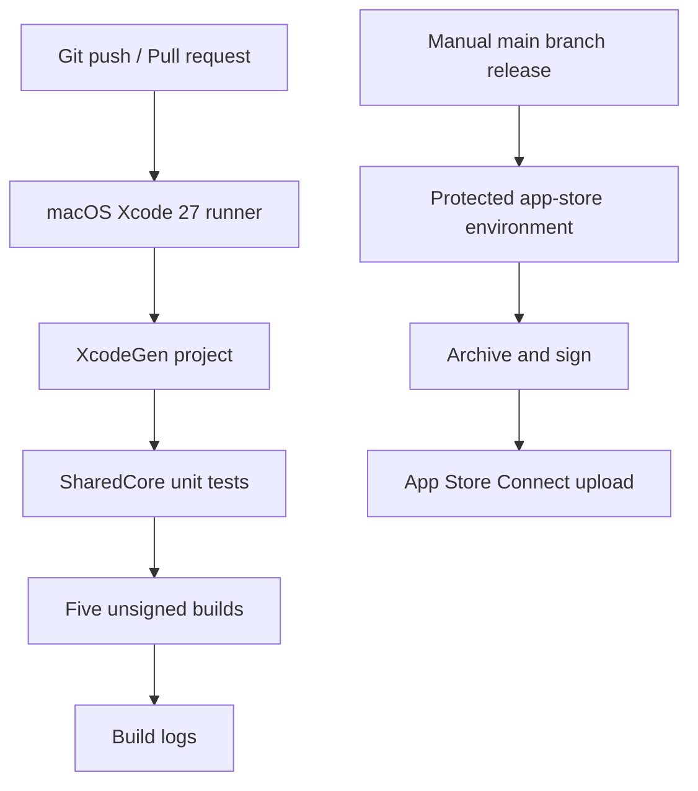

# CI and repository architecture

## Target boundaries

| Scheme | Platform | Scope |
| --- | --- | --- |
| `iOSApp` | iOS/iPadOS | iPhone, iPad, adaptive iPhone Duo UI |
| `MacApp` | macOS | Desktop windows and future menus |
| `WatchApp` | watchOS | Standalone Watch application |
| `TVApp` | tvOS | Television-native view |
| `VisionApp` | visionOS | Spatial window; immersive spaces are future work |

`SharedCore` has **no** SwiftUI dependency and can be tested independently; `Apps/Shared` contains the small SwiftUI UI surface compiled into each app. The iOS entry point adds `GeometryReader` plus a policy from `SharedCore` so wider Duo/iPad layouts do not stretch phone UI blindly.

## Separation of trust

| Pipeline | Trigger | Credentials | Output |
| --- | --- | --- | --- |
| CI | Push, PR, manual | None | Tests and unsigned builds |
| Release | Manual, on `main` | Protected GitHub environment | Uploaded build for the selected OS |

This deliberately prevents a third-party PR from accessing distribution credentials and keeps a reproducible log of every upload request. Account setup and code signing remain explicit prerequisites rather than hidden assumptions.

## Why no committed `.xcodeproj`?

A generated Xcode project tends to cause noisy conflicts and would require a Mac-based editor for some changes. `project.yml` is plain text and is turned into a native project by XcodeGen inside CI. All platform targets remain visible in one specification.

## Extension points

- Add platform-specific `Apps/<OS>/Features` directories as individual app functionality grows.
- Add Swift packages under `Packages/` for storage, networking, authentication, purchases, and domain modules.
- Add opt-in device-simulator UI-test workflows after reliable simulator availability is verified on GitHub's runner image.
- Add code-coverage reports, accessibility checks, and screenshots once Xcode-based test infrastructure is established.
- For unrelated commercial apps, use GitHub's **Use this template** feature to create separate repositories and bundle IDs.

## Release limitations

An automated upload is not a successful App Review submission. Before publishing, each app still needs its icon, store metadata, privacy declarations, screenshots, agreements, signing configuration, and appropriate functional/hardware testing.
